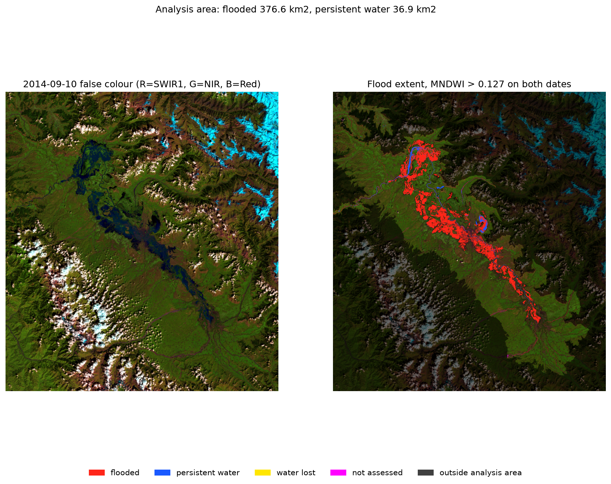

# The Kashmir flood, September 2014

About 377 km² of the Kashmir valley floor was under water on 2014-09-10 that had been dry on 2014-08-25.



A reproducible measurement of the flood in the Kashmir valley from two Landsat 8 images, taken on 2014-08-25 (before) and 2014-09-10 at 05:36 UTC (during). Website: https://panaum.github.io/kashmir-flood-2014/

Generated by `scripts/19_write_readme.py` from `docs/data/results.json`; the numbers below come from the recorded analysis outputs. Full method, every rule and every check: [METHODS.md](METHODS.md). Input files and checksums: [DATA.md](DATA.md).

## Results

Analysis area: the valley floor at or below 1,800 m that connects to Srinagar, 3,696.8 km². Water = MNDWI above 0.127 (Otsu on valid valley-floor pixels, flood date) on both dates; 30 m pixels. Range 361.5–423.2 km² spans threshold 0.177 (Otsu + 0.05) to 0.000 (zero on both dates).

| Measure | Value |
|---|---|
| Flooded on 2014-09-10 (water then, dry on 2014-08-25) | **376.6 km²** |
| Range across the threshold variants | 361.5 to 423.2 km² |
| Flooded, outside / inside OpenStreetMap lakes and wetlands | 257.5 / 119.1 km² |
| Water on both dates (river, lakes) | 36.9 km² |
| Water in August but not September | 0.24 km² |
| Not assessed (cloud or shadow on either date) | 0.55 km² (0.015 %) |
| Flooded inside the Srinagar box (lon…74.65–74.95, lat…33.95–34.20) | 161.3 km² |
| Motor roads on flooded ground (OpenStreetMap, 2026-10-01) | 893 of 10,713 km |
| Building footprints standing today on ground that flooded (Microsoft, imagery 2017–2021) | 42,016 to 55,950 depending on the counting rule (by centre / by any overlap), of 1,185,245 |

The building figure counts footprints in today's data on flooded ground. It is not a count of buildings flooded in 2014.

## Comparison with published estimates

This analysis gives 376.6 km² on 2014-09-10. Two published figures are recorded in `docs/data/external_estimates.json`:

- **DERS & ISRO (2014)**: 358.6 km² on 2014-09-10 (peak in their series 370.6 km² on 2014-09-08). This analysis is +5.0 % relative to that same-day figure. Citation: DERS & ISRO, 'A satellite-based rapid assessment on floods in Jammu & Kashmir - September 2014'. J&K Department of Environment and Remote Sensing with the Indian Space Research Organisation.
- **Bhatt et al. (2017)**: about 557 km² (SAR (RISAT-1 / Radarsat-2); cumulative extent over 8-23 September, not a single-date snapshot). Citation: Bhatt C.M., Rao G.S., Farooq M., Manjusree P., Shukla A., Sharma S.V.S.P., Kulkarni S.S., Srinivasa Rao G., Bhanumurthy V., Diwakar P.G. and Dadhwal V.K. (2017). Satellite-based assessment of the catastrophic Jhelum floods of September 2014, Jammu & Kashmir, India. Geomatics, Natural Hazards and Risk, 8(1), 268-284.

Caveats for any comparison: (a) this compares totals only, not pixel by pixel; (b) the analysis areas differ — area definitions are not stated in detail in all sources; (c) this comparison section was added after the results were computed and does not affect the pre-registered analysis steps.

## Reproduce

Tested with Python 3.13 on macOS. All downloads are checked (size, MD5 where the server gives one, sha256 recorded) and the scripts stop rather than guess when something is missing.

```
python3 -m venv .venv && .venv/bin/pip install -r requirements.txt
.venv/bin/python scripts/01_download.py               # Landsat 8 scenes
.venv/bin/python scripts/01b_mosaic.py                # rows 036 + 037 mosaic
.venv/bin/python scripts/02_preview.py                # cloud check, previews
.venv/bin/python scripts/03_write_data_md.py          # DATA.md
.venv/bin/python scripts/04_dem.py                    # Copernicus DEM
.venv/bin/python scripts/05_water.py                  # MNDWI, masks, Otsu, water masks
.venv/bin/python scripts/06_water_preview.py          # water previews
.venv/bin/python scripts/08_radsat.py                 # saturation band
.venv/bin/python scripts/09_osm.py                    # OSM lakes and wetlands
.venv/bin/python scripts/10_flood.py                  # flood extent
.venv/bin/python scripts/11_flood_preview.py          # flood previews
.venv/bin/python scripts/12_geofabrik_download.py     # OSM extract
.venv/bin/python scripts/12b_read_extract.py          # OSM buildings, roads, places
.venv/bin/python scripts/13_exposure.py               # OSM counts
.venv/bin/python scripts/14_exposure_preview.py       # OSM preview
.venv/bin/python scripts/15_msbuildings_download.py   # Microsoft footprints
.venv/bin/python scripts/16_msbuildings_count.py      # footprint counts
.venv/bin/python scripts/17_msbuildings_preview.py    # footprint preview
.venv/bin/python scripts/07_write_methods_md.py       # METHODS.md
.venv/bin/python scripts/18_site_data.py              # website data and layers
.venv/bin/python scripts/19_write_readme.py           # this README
```

Or run everything in order with `bash scripts/run_all.sh` (stops on first error). Script 07 (`write_methods_md`) is placed near the end because it reads all analysis outputs and cannot run until steps 08–17 are complete.

Raw and intermediate data go to `data/` (not committed, about 2.5 GB). OpenStreetMap and the Microsoft footprints change over time; a later run will use newer snapshots, recorded in METHODS.md. To view the website locally: `python3 -m http.server -d docs`.

## Limitations

- One moment: one image at 05:36 UTC on 2014-09-10, not the largest extent of the flood. The published daily series (DERS & ISRO) puts the peak around 2014-09-08, about two days before this image.
- The old city is probably undercounted: where roofs fill most of a 30 m pixel, water between them may not register. Not tested.
- Lakes covered by plants in August (parts of Wular and Dal) count as flooded where they were open water in September.
- Today's maps, not 2014's: roads from OpenStreetMap, buildings from imagery of 2017–2021.
- Clouds the satellite's own mask missed hide what is under them (rough estimate 1.4 km²).
- Only the valley floor connected to Srinagar was measured; the elevation model includes buildings and trees.
- See METHODS.md for every limitation and check.

## How this was made

This analysis was conducted by Anaum Pandit. Every rule for the flood and exposure steps was committed before the corresponding result was computed; the git history shows the order.

## Licences

- Code (`scripts/`, `docs/*.js`, `docs/*.css`, `docs/*.html`): MIT, see [LICENSE](LICENSE).
- Documents and outputs (README, METHODS.md, DATA.md, `previews/`, `docs/data/`, `docs/img/`): CC BY 4.0, see [LICENSE-docs.md](LICENSE-docs.md).
- Third-party data keep their own terms: Landsat (U.S. Geological Survey, public domain); Copernicus DEM GLO-30 (Copernicus licence, notice below); OpenStreetMap (ODbL 1.0); Microsoft Building Footprints (ODbL 1.0). Leaflet (BSD 2-Clause) and Bodoni Moda (SIL OFL 1.1) are included with their licences in `docs/vendor/` and `docs/fonts/`.
- Produced using Copernicus WorldDEM-30 © DLR e.V. 2010-2014 and © Airbus Defence and Space GmbH 2014-2018 provided under COPERNICUS by the European Union and ESA; all rights reserved. The organisations in charge of the Copernicus programme by law or by delegation do not incur any liability for any use of the Copernicus WorldDEM-30.
- Map data © OpenStreetMap contributors. Building footprints © Microsoft. No data provider has reviewed or endorses this work.

## How to cite

Pandit, A. (2026). *The Kashmir flood, September 2014: a reproducible Landsat 8 measurement* [software and data]. https://github.com/panaum/kashmir-flood-2014

Machine-readable citation: [CITATION.cff](CITATION.cff).
